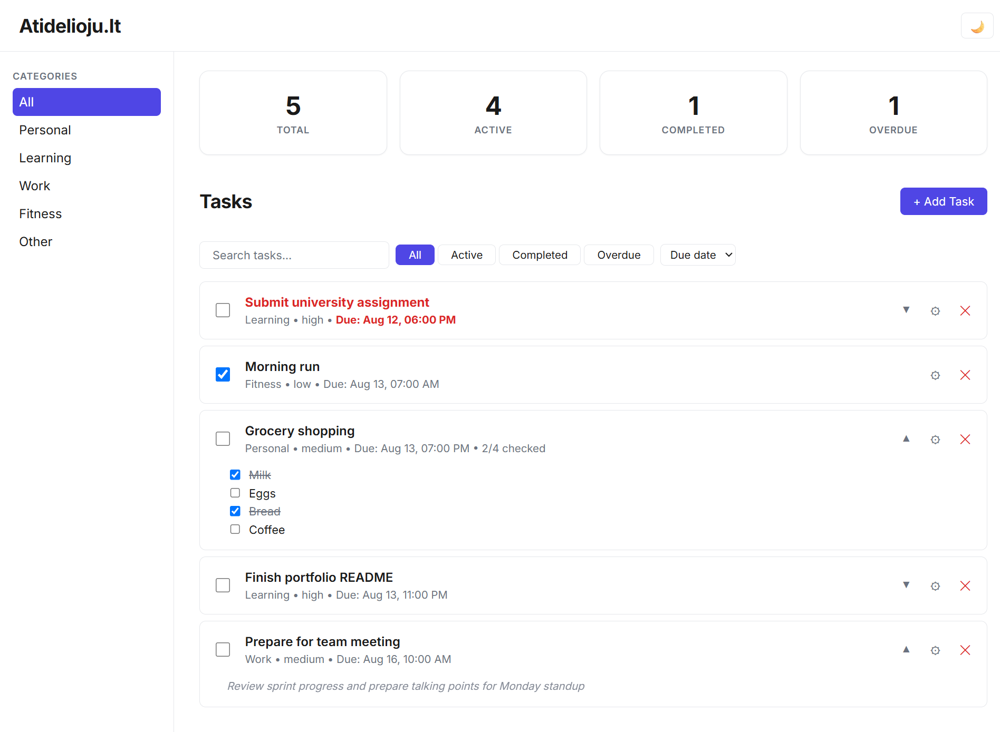
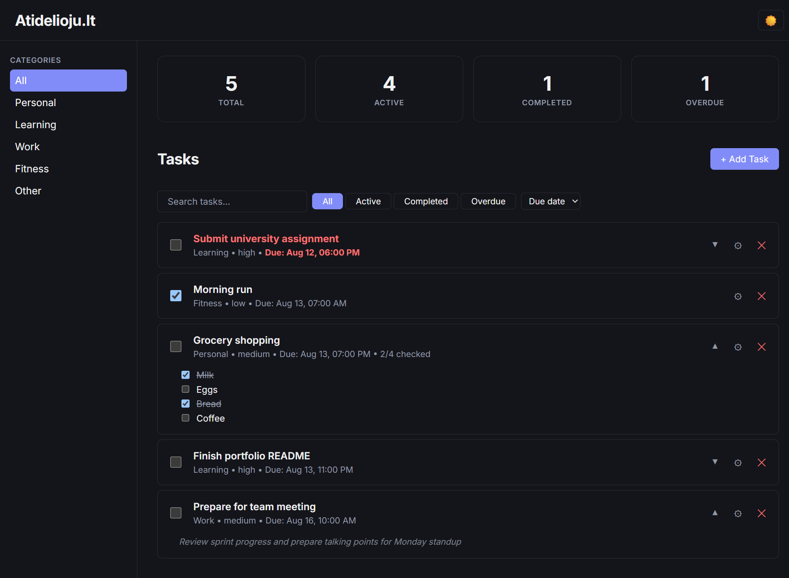
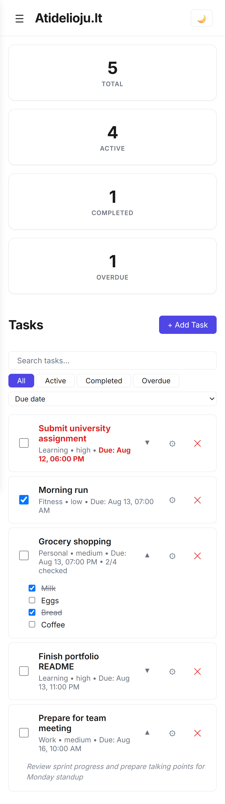
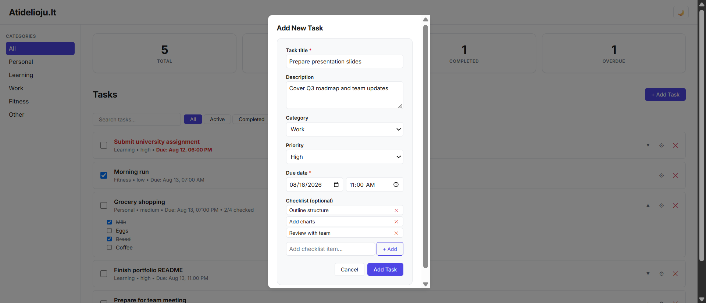

# Atidelioju.lt

A full-featured task management web app built with React, TypeScript, and Vite.

**Live demo:** [atidelioju-lt.vercel.app](https://atidelioju-lt.vercel.app)



## Features

- **Full CRUD** — create, edit, delete, and mark tasks as complete
- **Checklists** — optional sub-items per task (e.g. a shopping list); a task auto-completes when every item is checked
- **Live overdue detection** — due dates are tracked to the minute, and tasks flip to "overdue" in real time, without needing a refresh
- **Search, filter, and sort** — by title, status (All / Active / Completed / Overdue), and by due date, priority, newest, or oldest
- **Category navigation** — filter tasks by category from the sidebar, with a mobile-friendly slide-in drawer
- **Dark mode** — persisted across sessions
- **Persistence** — all data is saved to `localStorage`, so nothing is lost on refresh
- **Responsive design** — desktop, tablet, and mobile layouts
- **Accessible by default** — proper focus states, `aria-label`s on icon-only buttons, keyboard-friendly modals (Escape to close)

## Screenshots

| Light mode                                        | Dark mode                                       |
| ------------------------------------------------- | ----------------------------------------------- |
|  |  |

| Mobile view                                      | Add task modal                                         |
| ------------------------------------------------ | ------------------------------------------------------ |
|  |  |

## Tech stack

- **React 19** + **TypeScript** + **Vite**
- **CSS Modules** — no UI libraries, no Tailwind; a small custom design system (CSS custom properties for color, spacing, radius, and shadows) shared across all components
- No backend, no database, no state management library — state lives in React (`useState`/`useEffect`) and syncs to `localStorage`

These constraints were intentional: the goal of this project was to build strong React and TypeScript fundamentals before introducing additional tools.

## Getting started

```bash
git clone https://github.com/AD0MAS/atidelioju-lt.git
cd atidelioju-lt
npm install
npm run dev
```

The app will be available at `http://localhost:5173`.

## Project structure

```
src/
├── components/     # Reusable UI components (TaskForm, TaskItem, Modal, etc.)
├── pages/          # Dashboard and Tasks page-level components
├── types/          # Shared TypeScript types
├── constants/      # Shared constants (categories, priorities, filters) with derived types
├── utils/          # Task-related helper functions (overdue check, date formatting)
├── hooks/          # Custom hooks (useNow — drives live overdue updates)
├── App.tsx         # Root component: owns shared state and localStorage persistence
└── main.tsx        # Entry point
```

## Notable implementation details

- **Derived state throughout** — dashboard stats, overdue status, and checklist completion are all computed from existing data rather than tracked separately, so they can never drift out of sync.
- **Type-safe constants** — categories, priorities, and filters are each defined once as a `const` array, with their TypeScript type derived from it (`typeof X[number]`), so the UI and the type system can never disagree.
- **Shared form component** — the same `TaskForm` component handles both creating and editing a task, reused via props rather than duplicated.
- **Live-updating overdue state** — a custom `useNow` hook refreshes the current time on an interval, so a task visually flips to "overdue" the moment its due date passes, with no user interaction required.

## License

This project is open source and available under the [MIT License](LICENSE).
